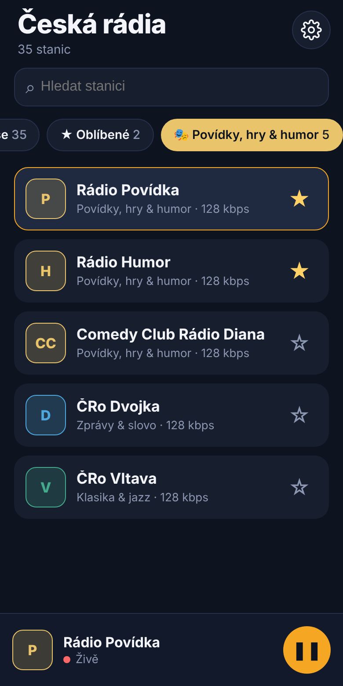
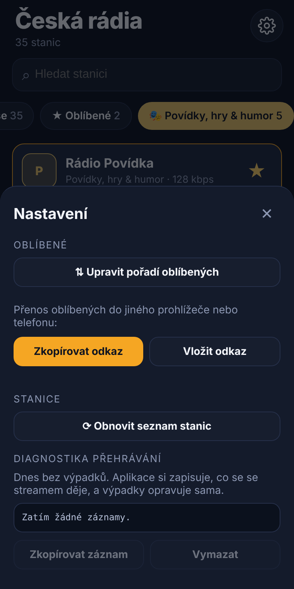

# 📻 Česká rádia

Jednoduchá webová aplikace pro poslech českých internetových rádií, rozdělených podle žánrů.
Funguje v prohlížeči na iPhonu, Androidu i počítači a dá se přidat na plochu telefonu jako běžná aplikace.

**▶ Spustit aplikaci: [jakubherlitze-99.github.io/radio](https://jakubherlitze-99.github.io/radio/)**

<p align="center">
  
  &nbsp;&nbsp;
  
</p>

## Obsah

- [Funkce](#funkce)
- [Instalace na telefon](#instalace-na-telefon)
- [Žánry a stanice](#žánry-a-stanice)
- [Jak to funguje](#jak-to-funguje)
- [Struktura projektu](#struktura-projektu)
- [Vývoj a nasazení](#vývoj-a-nasazení)
- [Přidání stanice](#přidání-stanice)
- [Známá omezení](#známá-omezení)
- [Zdroje dat](#zdroje-dat)

## Funkce

- **Žánry** – Povídky, hry & humor, Zprávy & slovo, Pop & hity, Rock & alternativa, Dance & elektro,
  Oldies & retro, Klasika & jazz, Country, folk & dechovka, Pro děti, Duchovní.
- **Přes 150 stanic** – 35 ověřených stanic nahoře, pod nimi další české stanice z otevřeného katalogu.
- **Hledání** podle názvu stanice.
- **Oblíbené** ★ s vlastním pořadím (přetažení za úchyt ≡ nebo šipky ▲ ▼).
- **Přenos oblíbených** do jiného prohlížeče či telefonu pomocí odkazu.
- **Ovládání ze zamčené obrazovky** – pauza / přehrát a přepínání stanic (tlačítka ⏮ ⏭, na iOS ±10 s).
- **Rychlý start** – stanice začne hrát hned, zásobník se plní za běhu.
- **Automatická oprava výpadků** – opětovné připojení při zaseknutí či ukončení streamu,
  hlídání „tichého“ zamrznutí, čekání na návrat internetu, záložní adresy streamů.
- **Diagnostika přehrávání** – záznam událostí (výpadky, opravy, síť) přímo v aplikaci, lze ho zkopírovat.
- **Funguje offline** – aplikace se uloží do zařízení (service worker); pro poslech je potřeba internet.

## Instalace na telefon

| Zařízení | Postup |
| --- | --- |
| **iPhone / iPad** | Otevři odkaz v **Safari** → **Sdílet** (čtvereček se šipkou) → **Přidat na plochu** |
| **Android** | Otevři odkaz v **Chrome** → menu **⋮** → **Instalovat aplikaci** / **Přidat na plochu** |
| **Počítač** | Stačí otevřít odkaz; v Chrome / Edge lze aplikaci nainstalovat ikonou v adresním řádku |

> [!TIP]
> Na iPhonu mají Safari a ikona na ploše oddělené úložiště. Oblíbené z jednoho do druhého přeneseš přes
> **⚙️ → Zkopírovat odkaz** a v cílové aplikaci **⚙️ → Vložit odkaz**.

## Žánry a stanice

Výběr ověřených stanic (s ručně zkontrolovanou zabezpečenou adresou streamu):

| Žánr | Stanice |
| --- | --- |
| 🎭 Povídky, hry & humor | Rádio Povídka, Rádio Humor, Comedy Club Rádio Diana, ČRo Dvojka, ČRo Vltava |
| 🗞 Zprávy & slovo | ČRo Radiožurnál, ČRo Plus, ČRo Dvojka, ČRo Radiožurnál Sport |
| 🎤 Pop & hity | Evropa 2, Frekvence 1, Rádio Impuls, Kiss, Hitrádio, Fajn Rádio, Rádio Krokodýl, Rádio Čas |
| 🎸 Rock & alternativa | Rock Radio, Radio Beat, Radio 1, ČRo Radio Wave, Rádio Čas Rock |
| 🎧 Dance & elektro | Dance Radio, Rádio Spin |
| 📼 Oldies & retro | Rádio Blaník, Oldies Rádio, Retro Club Rádio Diana, ČRo Pohoda |
| 🎻 Klasika & jazz | ČRo Vltava, ČRo D-dur, ČRo Jazz, Classic Praha |
| 🪕 Country, folk & dechovka | Country Radio |
| 🧸 Pro děti | Rádio Pohádka, Rádio Junior |
| 🕊 Duchovní | Rádio Proglas, Rádio 7 |

Ostatní stanice se načítají z katalogu a do žánrů se řadí automaticky podle štítků.

## Jak to funguje

- Čistý **HTML + CSS + JavaScript** bez frameworků a bez sestavování – stačí statický hosting.
- Seznam českých stanic se načítá z API [Radio Browser](https://www.radio-browser.info) a ukládá se na 24 hodin.
- U vybraných stanic má přednost ručně ověřená adresa streamu (`stream` v `stations.js`).
- Přehrávají se jen **https** streamy (stránka běží přes https) a formáty, které zvládne iPhone
  (MP3/AAC; Ogg a FLAC se vynechávají).
- Oblíbené, pořadí, poslední stanice a diagnostika se ukládají do `localStorage` zařízení.
- Ovládání ze zamčené obrazovky zajišťuje [Media Session API](https://developer.mozilla.org/docs/Web/API/Media_Session_API).

## Struktura projektu

```
.
├── index.html             # kostra stránky
├── style.css              # vzhled (tmavý motiv)
├── app.js                 # logika: katalog, přehrávač, oblíbené, nastavení, diagnostika
├── stations.js            # žánry, ověřené stanice a pravidla řazení podle štítků
├── sw.js                  # service worker (offline běh aplikace)
├── manifest.webmanifest   # údaje pro instalaci na plochu
├── icons/                 # ikony aplikace
├── docs/                  # snímky obrazovky pro README
└── expo-app/              # nativní varianta (Expo / React Native) – zatím jen prototyp
```

## Vývoj a nasazení

Lokální spuštění (jakýkoli statický server):

```bash
git clone https://github.com/jakubherlitze-99/radio.git
cd radio
python3 -m http.server 8000
# otevři http://localhost:8000
```

Nasazení probíhá přes **GitHub Pages** z větve `main` (kořenová složka) – po `git push` je nová
verze online zhruba do minuty.

> [!NOTE]
> Po změně souborů zvyš verzi cache v `sw.js` (`ceska-radia-vN`), aby si nainstalované aplikace
> novou verzi spolehlivě stáhly.

## Přidání stanice

Do pole `CURATED` v [`stations.js`](stations.js) přidej řádek:

```js
{ id: 'moje-radio', name: 'Moje Rádio', genre: 'pop',
  stream: 'https://example.cz/stream.mp3',   // volitelné: ověřená https adresa
  match: ['moje radio'] },                   // slova pro dohledání v katalogu (bez diakritiky)
```

Další volitelné položky: `also: ['spoken']` (zobrazit i v jiném žánru), `alt: [...]` (záložní adresy),
`exclude: [...]` (slova, která v názvu být nesmí).

## Známá omezení

- **Zamčený iPhone:** iOS webovým aplikacím na pozadí nedovolí otevřít nové spojení. Když stream
  úplně spadne, aplikace se rozjede po odemknutí nebo po klepnutí na ▶ / ⏸ na zamčené obrazovce.
  Plně spolehlivé přehrávání na pozadí umožní až nativní aplikace (`expo-app/`).
- **Tlačítka ±10 s:** iOS je u webových aplikací na zamčené obrazovce ponechává; v aplikaci přepínají stanice.
- **Stanice jen přes http** (bez https) nelze ve webové aplikaci přehrát, a proto v seznamu chybí
  (např. Rádio Dechovka).
- Synchronizace oblíbených mezi zařízeními je ruční (odkazem), aplikace nemá vlastní server.

## Zdroje dat

- Katalog stanic: [Radio Browser](https://www.radio-browser.info) (otevřená komunitní databáze)
- Streamy a loga patří jednotlivým provozovatelům rozhlasových stanic.
  Aplikace je neoficiální a s provozovateli stanic není nijak spojena.
